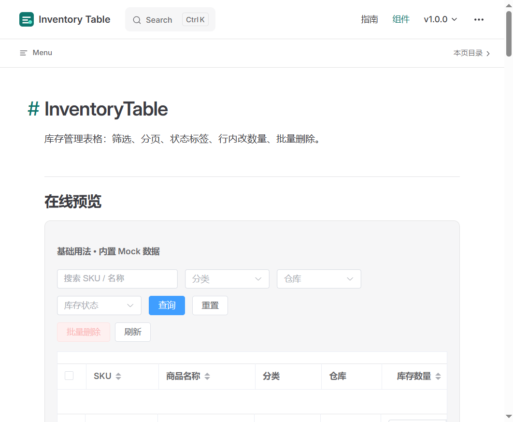

# @inventory-table/vue

Vue 3 + TypeScript 库存表格组件，基于 Element Plus。筛选、分页、库存状态、行内改数量、批量操作开箱即用，适合发布到 npm / 开源仓库 / 插件市场。



## 在线预览

- **文档站 Demo**：[https://dengxinliang.github.io/inventory-table/](https://dengxinliang.github.io/inventory-table/)
- **组件页直达**：[https://dengxinliang.github.io/inventory-table/components/inventory-table](https://dengxinliang.github.io/inventory-table/components/inventory-table)

> 本地预览：`npm install && npm run docs:dev`，默认打开 `http://localhost:5173/inventory-table/`

## 特性

- Vue 3 `<script setup>` + TypeScript
- props / emits / mock / types 文件级抽离
- 库存状态自动识别：充足 / 偏低 / 缺货
- 工具栏筛选、分页、多选、行内数量编辑
- 客户端过滤与服务端分页双模式
- ESM + UMD 双格式，完整 `.d.ts` 与样式导出

## 安装

```bash
npm install @inventory-table/vue element-plus
# 或
pnpm add @inventory-table/vue element-plus
# 或
yarn add @inventory-table/vue element-plus
```

### 全局注册

```ts
import { createApp } from 'vue'
import ElementPlus from 'element-plus'
import 'element-plus/dist/index.css'
import InventoryTablePlugin from '@inventory-table/vue'
import '@inventory-table/vue/style.css'
import App from './App.vue'

createApp(App).use(ElementPlus).use(InventoryTablePlugin).mount('#app')
```

### 按需引入

```vue
<script setup lang="ts">
import { InventoryTable } from '@inventory-table/vue'
import '@inventory-table/vue/style.css'
</script>

<template>
  <InventoryTable use-mock />
</template>
```

## 示例代码

```vue
<script setup lang="ts">
import { ref } from 'vue'
import {
  InventoryTable,
  type InventoryItem,
} from '@inventory-table/vue'
import '@inventory-table/vue/style.css'

const data = ref<InventoryItem[]>([
  {
    id: 1,
    sku: 'SKU-10001',
    name: '无线蓝牙耳机 Pro',
    category: '数码配件',
    warehouse: '上海仓',
    quantity: 128,
    lowStockThreshold: 20,
    unitPrice: 299,
    unit: '件',
    updatedAt: '2026-11-01T10:20:00',
  },
])

function onDelete(row: InventoryItem) {
  data.value = data.value.filter((item) => item.id !== row.id)
}
</script>

<template>
  <InventoryTable
    :data="data"
    @delete="onDelete"
    @edit="(row) => console.log('edit', row)"
    @quantity-change="({ row, quantity }) => (row.quantity = quantity)"
  />
</template>
```

## 参数文档

### Props

| 参数 | 说明 | 类型 | 默认值 |
| --- | --- | --- | --- |
| `data` | 表格数据 | `InventoryItem[]` | `[]` |
| `columns` | 自定义列 | `InventoryColumn[]` | `[]` |
| `loading` | 加载中 | `boolean` | `false` |
| `showToolbar` | 显示工具栏 | `boolean` | `true` |
| `showPagination` | 显示分页 | `boolean` | `true` |
| `selectable` | 开启多选 | `boolean` | `true` |
| `showActions` | 显示操作列 | `boolean` | `true` |
| `pageSizes` | 每页条数选项 | `number[]` | `[10, 20, 50, 100]` |
| `pageSize` | 初始每页条数 | `number` | `10` |
| `total` | 服务端总数（传入后关闭客户端切片） | `number` | — |
| `defaultLowStockThreshold` | 默认低库存阈值 | `number` | `10` |
| `categoryOptions` | 分类筛选项 | `string[]` | `[]` |
| `warehouseOptions` | 仓库筛选项 | `string[]` | `[]` |
| `query` | 受控查询条件 | `InventoryQuery` | — |
| `maxHeight` | 表格最大高度 | `string \| number` | — |
| `stripe` | 斑马纹 | `boolean` | `true` |
| `border` | 边框 | `boolean` | `true` |
| `emptyText` | 空状态文案 | `string` | `暂无库存数据` |
| `currency` | 货币符号 | `string` | `¥` |
| `useMock` | 无数据时使用内置 mock | `boolean` | `false` |

### Events

| 事件名 | 说明 | 回调参数 |
| --- | --- | --- |
| `selection-change` | 多选变化 | `(rows: InventoryItem[])` |
| `search` | 查询 / 重置 | `(query: InventoryQuery)` |
| `page-change` | 分页变化 | `(pagination: InventoryPagination)` |
| `view` / `edit` / `delete` | 行操作 | `(row: InventoryItem)` |
| `batch-delete` | 批量删除 | `(rows: InventoryItem[])` |
| `quantity-change` | 行内改数量 | `({ row, quantity })` |
| `status-click` | 点击状态标签 | `({ row, status })` |
| `refresh` | 刷新 | `()` |

### InventoryItem

```ts
interface InventoryItem {
  id: string | number
  sku: string
  name: string
  category: string
  warehouse?: string
  quantity: number
  lowStockThreshold?: number
  unitPrice?: number
  unit?: string
  updatedAt?: string
  remark?: string
}
```

完整 API 见文档：[Components / InventoryTable](https://dengxinliang.github.io/inventory-table/components/inventory-table)

## 本地开发

```bash
npm install
npm run docs:dev      # VitePress 文档 + 组件 Demo
npm run build         # 构建可发布的 npm 包（dist）
npm run docs:build    # 构建静态文档站
```

目录结构：

```
src/components/InventoryTable/
  InventoryTable.vue   # 组件主体
  props.ts             # Props 定义
  emits.ts             # Emits 定义
  types.ts             # 类型
  mock.ts              # Mock 数据
  utils.ts             # 状态 / 格式化工具
docs/                  # VitePress 预览站
```

## 发布到 npm

```bash
npm run build
npm publish --access public
```

发布前请将 `package.json` / README 中的 `dengxinliang` 替换为实际组织或用户名，并配置 GitHub Pages（`docs:build` 产物目录为 `docs/.vitepress/dist`）。

## 授权协议

[MIT License](./LICENSE) © 2026 Inventory Table Contributors
